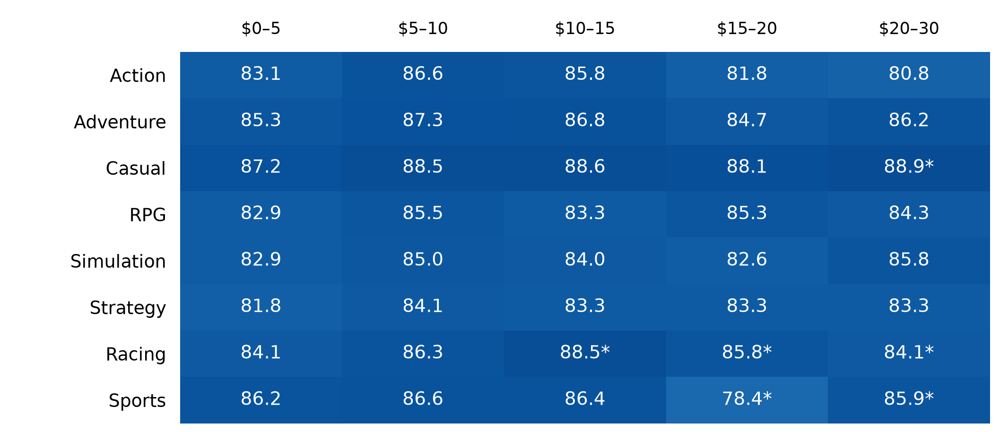

# Steam indie games: pricing, genres and achievements

I used Steam game records to explore a question: what can an indie developer learn from the prices, genres and achievement counts of existing games?

The final comparison includes **8,467 Indie-labelled games** released between January 2019 and December 25, 2025, with at least 100 recorded reviews. Player reception means positive reviews divided by total reviews; it is not a sales measure.

## What I found

- Genre mattered when comparing recorded prices. At $5–15, Casual games had median positive-review shares of 88.5–88.6%, compared with 83.3–84.1% for Strategy.
- Games with 10–29 achievements were common across reception tiers, including poorly reviewed games. The results do not establish a best count.
- Among games with achievements, RPG and Strategy had median counts of 35, compared with 24 for Casual.



Cells show median positive-review percentages; * marks fewer than 30 games. Zero prices and prices above $30 are omitted here.

Read the [two-page report](reports/Indie_Analysis.pdf) for the charts and limitations.

## Run it

1. Download `games.csv` from the [Kaggle dataset](https://www.kaggle.com/datasets/fronkongames/steam-games-dataset) and place it beside the notebooks. The raw data is not included here.
2. Use Python 3.11 or newer and install the dependencies:

   ```sh
   python -m pip install -r requirements.txt
   python -m notebook
   ```

3. Open `01_data_loading.ipynb` to follow the cleaning, `02_analysis.ipynb` for genre and price, or `03_achievements.ipynb` for achievements. Each analysis notebook loads preparation automatically; use **Run All** from a fresh Python kernel.

## Limits

Coverage and review freshness are uneven. Prices may be discounted or stale; zero prices are kept only with a Free To Play label. Genre labels overlap, and some groups are small. The filters narrow the sample but cannot repair missing source data. These comparisons describe associations, not a formula for sales or better reviews.

A newer Kaggle download may produce different counts. The published outputs use the 125,855-record file analysed in this project.

Made by **Ziyad Alali**.
